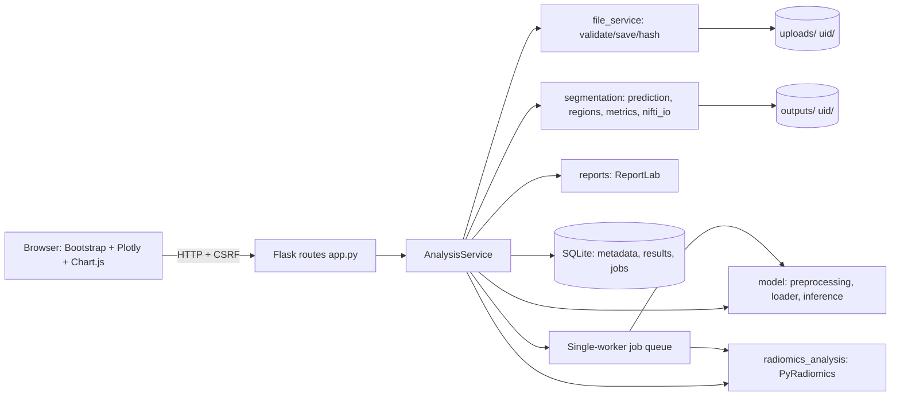

# Architecture

**Data flow:** upload → `file_service` (extension whitelist, magic-byte sniff, server-side name `<role>.nii[.gz]`, SHA-256) → `validate_modalities` (shape/affine/orientation/spacing/finite) → DB row `validated` → job `segmentation` (preprocess → inference → label mapping → NIfTI with original affine → regions/volumes → QC warnings) → radiomics/evaluation jobs read files, write rows → report built from DB + files.

**Concurrency:** one worker thread executes heavy jobs (serialised); `processing_jobs` table + atomic `BEGIN IMMEDIATE` prevents duplicate jobs per examination; on restart, running jobs are marked `interrupted` and `partial_*` files removed. Concurrent *submission* from multiple users is queued, not parallel. This is tested only for the duplicate-submission guard and restart recovery (unit tests), not under load.

**Why files, not blobs:** MRI volumes are tens of MB; SQLite stores metadata, hashes, relative file names and results.
